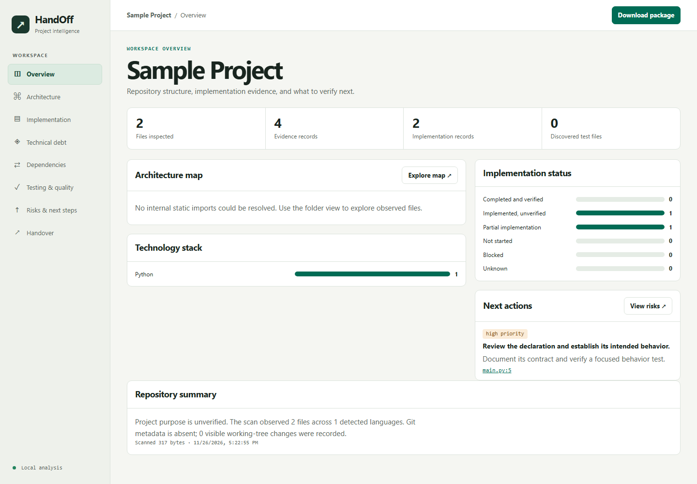

# HandOff

Don't lose the work. Hand over the context.

HandOff builds local, evidence-based handovers for developers and coding agents.

A README explains how a project is meant to work. A handover also needs the
current revision, working changes, implementation gaps, and what was actually
verified. HandOff inventories a project and turns those observations into two
Markdown documents with traceable evidence IDs.

The [VS Code extension](vscode-extension/README.md) adds an interactive
dashboard, source navigation, and an offline handover package. See the
[visual platform documentation](docs/visual-platform.md) for the data contract
and export layout.



## Install the VS Code extension

The first VSIX release is pending. Build a local candidate using the [release guide](docs/releasing.md). In desktop VS Code,
choose **Extensions → … → Install from VSIX…**, or run:

```sh
code --install-extension ./handoff-project-intelligence-0.1.0.vsix
```

Open a trusted local folder, run **HandOff: Analyze Current Repository**, and
approve first-time engine setup. Python 3.11 or newer is required. See the
[installation guide](docs/installation.md) for setup, manual updates, and rollback.

## Install the CLI

Use Python 3.11 or newer. From the HandOff source directory, create and activate
a virtual environment, then run:

```sh
python -m pip install .
handoff --help
```

Scanning and report generation run offline after installation. Git is optional.
Use `python -m handoff` when the platform restricts generated console launchers.

## Try it

```sh
handoff init --path examples/sample-project
handoff scan --path examples/sample-project
handoff generate --path examples/sample-project
handoff check --path examples/sample-project
handoff validate --path examples/sample-project
```

The example produces a human `HANDOFF.md` and an operational
`HANDOFF_AGENT.md`. The report identifies the existing `add` function body as
implemented and unverified and the `reset` placeholder as partial, with the
scope of the intended feature marked uncertain. Both findings link to source
locations. HandOff does not execute the example.

Use `--path` with any project directory. Use `scan --json` for the structured
snapshot, `status` for saved progress, and `explain ID` for supporting evidence.
Run `update` after repository changes to review proposed changes and preserve
notes outside the managed block. See the [CLI reference](docs/cli-reference.md).

## Coding agent integration

The checkout includes project-local copies for Codex and Claude Code. To
install those copies in a different project, run
`handoff skill --path PROJECT --provider both`. Start a new session and invoke
`$handoff` in Codex or `/handoff` in Claude Code. The skill also describes
an evidence-gathering workflow using the agent's native tools when the CLI is
unavailable. See [the portable skill](SKILL.md).

The installation locations follow the
[Codex project skill layout](https://developers.openai.com/api/reference/cli)
and [Claude Code project skill layout](https://code.claude.com/docs/en/skills).

## Design and privacy

The scanner captures file types, landmarks, bounded Git metadata, source
markers, and optional JUnit counts. It keeps raw source and logs out of the
generated sections. Review path names and manual notes before sharing reports.
Python receives the deepest inspection. Architecture, objectives, feature-level
verification, and setup commands often require human review.

- [Architecture](docs/architecture.md)
- [Evidence model](docs/evidence-model.md)
- [Security](docs/security.md)
- [Limitations](docs/limitations.md)

## Distribution

Repository owners run the [private exclusion preflight](docs/private-exclusion-policy.md) before release.

GitHub Releases is the primary VSIX channel. HandOff is free under MIT. See the
[release guide](docs/releasing.md), [release verification](docs/release-verification.md),
and [future web distribution proposal](docs/web-distribution-proposal.md).

## Development

```sh
python -m pip install -e ".[dev]"
ruff check .
ruff format --check .
pytest -ra --cov=handoff
python -m build
```

See [Contributing](CONTRIBUTING.md), [the evaluation plan](docs/evaluation.md),
and [the MIT license](LICENSE).
